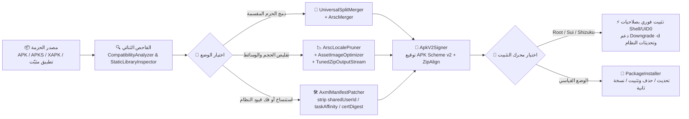
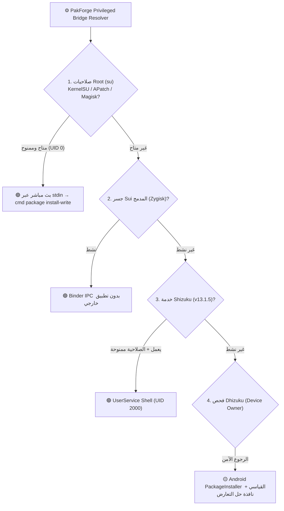
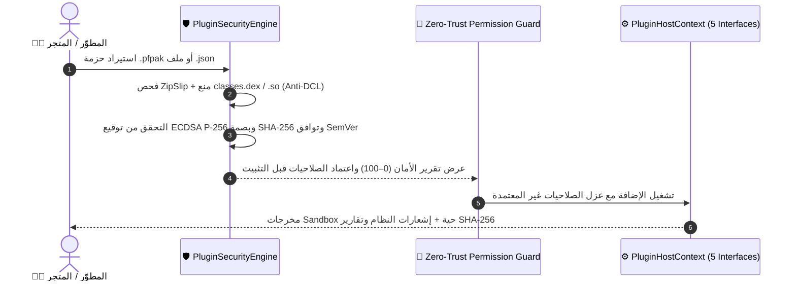

<div align="center">


# ⚡ PakForge — محرك ضغط وتوحيد وتثبيت حزم أندرويد المتقدم

**منظومة أندرويد متكاملة لضغط الحزم (`APK` / `APKS` / `XAPK`)، دمج الحزم المقسمة (`Anti-Split`)، استنساخ التطبيقات، المعالجة الثنائية لـ `Manifest` و`resources.arsc`، جسر الصلاحيات المتعدد، ومتجر الإضافات الموقّع بـ `ECDSA P-256`.**

<p>
  
  
  
  
  
</p>

<p>
  <a href="#-نظرة-عامة-ومحاور-النظام">🇸🇦 التوثيق العربي</a> •
  <a href="#-خرائط-المعمارية-ومسار-العمل">🗺️ الخرائط الهندسية</a> •
  <a href="#-نظام-الإضافات-ومتجر-التطبيقات-الموسّع">🧩 متجر الإضافات والـ SDK</a> •
  <a href="#-البناء-التلقائي-على-github-actions">🚀 GitHub CI/CD</a> •
  <a href="#-english-overview">🇬🇧 English Guide</a>
</p>

</div>

---

## 🎯 نظرة عامة ومحاور النظام

تم تصميم **PakForge** ليكون ورشة عمل هندسية متكاملة على جهاز أندرويد نفسه، بعيداً عن الحلول السطحية أو المحاكاة، حيث ينفّذ كل تعديل وضغط وتوقيع وتثبيت عبر محركات برمجية ثنائية (`Binary AXML / ARSC / ZIP / APK v2`) وواجهات نظام أصلية (`KernelSU / APatch / Magisk / Sui / Shizuku / PackageInstaller`).

<div align="center">
  
</div>

### أبرز القدرات الهندسية في التطبيق

| المحور | القدرات التقنية الفعلية | الوحدات المسؤولة |
| :--- | :--- | :--- |
| **1. دمج الحزم وضغطها (`Forge Core`)** | دمج `base.apk` + `split_*.apk` (`DEX`، `lib/.so`، `assets`، `res`، ودمج `resources.arsc`) في ملف `APK` موحّد (`Anti-Split`) مع ضغط ذكي متوافق مع الذاكرة ومحازاة `ZipAlign 4B/Page`. | `UniversalSplitMerger`, `ArscMerger`, `SmartPackageEngine`, `TunedZipOutputStream` |
| **2. التعديل الثنائي العميق (`Binary Patcher`)** | تقليم اللغات غير المستخدمة في `resources.arsc` (`Locale Pruning`)، ضغط الصور الثقيلة `PNG/WebP`، تجريد `android:sharedUserId`، تصحيح `certDigest` للمكتبات الثابتة (`Trichrome`)، وعزل `taskAffinity` والأيقونة للاستنساخ الموازي. | `ArscLocalePruner`, `AssetImageOptimizer`, `AxmlManifestPatcher`, `ArscPackagePatcher`, `CloneIconStyler` |
| **3. فحص التوافق والاستباقي (`Pre-Flight Inspector`)** | تحليل جاهزية التثبيت قبل الضغط: كشف `Split APKs`، بصمات الشهادات، تضارب التوقيع، ومستوى المخاطر مع أزرار الإصلاح التلقائي أو نسخ المكتبات المرافقة. | `CompatibilityAnalyzer`, `StaticLibraryInspector` |
| **4. التثبيت متعدد الجسور (`Privileged Bridge`)** | التوافق التلقائي مع **KernelSU / APatch / Magisk Root (`su` UID 0)**، و**Sui (Zygisk)**، و**Shizuku (`UID 2000`)**، وفحص **Dhizuku**، مع معالجة ذكية لحالات التعارض (تحديث، إزالة وتثبيت، أو استنساخ بجانب النسخة الأصلية). | `RootShellExecutor`, `DhizukuProbe`, `PakForgeInstaller`, `ApkV2Signer` |
| **5. متجر الإضافات و`Plugin SDK`** | حزمة مطورين قابلة للتصدير بصيغة `.zip`، توقيع رقمي **`ECDSA P-256` (`SHA256withECDSA`)** لحزم `.pfpak`، ماسح أمان يمنع تحميل الأكواد العشوائية (`Anti-DCL`)، ومحرك توصيات ذكي يرشّح الإضافة الأنسب لحزمتك وعتاد جهازك. | `PluginStoreCatalog`, `PluginSecurityEngine`, `SmartPluginRecommender`, `PluginManager` |
| **6. واجهة متعددة اللغات (`6 Languages + RTL`)** | دعم كامل ومتزامن عبر الشاشات الرئيسية والنوافذ المنبثقة بـ 6 لغات: **العربية (RTL)**، الإنجليزية، الإسبانية، الفرنسية، الألمانية، والصينية المبسطة. | `LocaleHelper`, `PluginLocalization` |

---

## 🗺️ خرائط المعمارية ومسار العمل

### 1. مسار معالجة الحزمة من الفحص حتى التثبيت (`End-to-End Pipeline`)



---

### 2. هرمية جسور الصلاحيات التلقائية (`Multi-Backend Privilege Hierarchy`)

يتحقق PakForge من الجسور المتوفرة على الجهاز بالترتيب التالي، مع إمكانية التحديد اليدوي من **الإعدادات**:



---

## 🧩 نظام الإضافات ومتجر التطبيقات الموسّع (`Plugin Store & SDK`)

<div align="center">
  
</div>

يتيح **مركز الإضافات والمطورين** (حصرياً داخل **الإعدادات ← الإضافات والمطورون**) إضافة أدوات وتخصيصات جديدة داخل `.pfpak` دون الحاجة لإعادة بناء التطبيق بالكامل، مع حماية صارمة بصلاحيات منفصلة وتوقيع تشفيري:



### واجهات الـ SDK الخمس الموحدة (`PakForge SDK v1.0.0`)

| الواجهة البرمجية | الصلاحية المطلوبة | الدور الفعلي داخل التطبيق |
| :--- | :--- | :--- |
| **`DeviceInterface`** | `READ_DEVICE_TELEMETRY` | قراءة الرام المتاحة، أنوية المعالج، المعماريات (`ABIs`)، وضع توفير الطاقة، وحجم مخزن الضغط المثالي. |
| **`DiagnosticsInterface`** | `READ_DIAGNOSTICS` | فحص حالة `Root / Sui / Shizuku / Dhizuku` وتشخيص مخاطر الحزمة الحالية. |
| **`ReportsInterface`** | `READ_REPORTS` | قراءة سجل العمليات السابقة، إجمالي المساحة المُحرّرة، وملخصات التدقيق بصيغة JSON. |
| **`NotificationInterface`** | `SEND_NOTIFICATIONS` | إرسال تنبيهات حقيقية إلى مركز إشعارات أندرويد وسجل المطورين الداخلي. |
| **`HostToolsInterface`** | `ACCESS_HOST_TOOLS` / `PRIVILEGED_SHELL_READ` | حساب بصمة `SHA-256`، تلخيص التوافق، تطبيق قواعد الضغط التلقائي، والاستعلام عن `UID`. |

---

## 📂 هيكل المشروع (`Architecture Map`)

```text
PakForge/
├── .github/
│   └── workflows/
│       └── android-ci.yml              # مسار البناء والاختبار والإصدار التلقائي على GitHub Actions
├── docs/
│   └── images/                         # صور الشرح والبانرات الهندسية عالية الدقة
├── gradle/
│   ├── libs.versions.toml              # كتالوج الاعتماديات المركزي (AGP 9.1.1 / Compose / Room / Shizuku)
│   └── wrapper/gradle-wrapper.properties
└── app/src/
    ├── main/java/com/example/
    │   ├── core/
    │   │   ├── engine/                 # Split Merger, ARSC Pruner, Image Optimizer, AXML Patcher, Smart Engine
    │   │   ├── signing/                # توقيع APK Scheme v2 (ApkV2Signer)
    │   │   ├── installer/              # PakForgeInstaller & InstallResultReceiver
    │   │   ├── privileged/             # Root (KernelSU/APatch/Magisk), Sui, Dhizuku Probes
    │   │   ├── shizuku/                # ربط خدمة Shizuku v13.1.5
    │   │   ├── telemetry/              # مراقبة الرام والمعالج في الوقت الحقيقي
    │   │   └── sdk/                    # Plugin APIs, ECDSA .pfpak Store, Security Scanner, Smart Recommender
    │   ├── data/                       # Room Database & DataStore Preferences
    │   └── ui/                         # Jetpack Compose Screens, Theme (Material 3) & LocaleHelper (6 Languages)
    └── test/java/com/example/          # اختبارات الوحدة وRobolectric الشاملة
```

---

## 🚀 البناء التلقائي على GitHub Actions

تم إعداد ملف [`.github/workflows/android-ci.yml`](.github/workflows/android-ci.yml) ليعمل مباشرةً بمجرد رفع الكود على GitHub (`push` أو `pull_request` أو إطلاق `tag` يبدأ بـ `v*`):

1. **المرحلة الأولى (`unit-tests`)**:
   - تهيئة **JDK 21 (Temurin)** و**Android SDK** و**Gradle 9.3.1**.
   - استعادة `debug.keystore` تلقائياً من `debug.keystore.base64`.
   - تشغيل جميع اختبارات الوحدة و**Robolectric Compose UI Tests** (`:app:testDebugUnitTest`) ورفع تقارير الاختبار.
2. **المرحلة الثانية (`build-apks`)**:
   - بناء نسخة الاختبار **`PakForge-debug.apk`**.
   - بناء نسخة الإصدار الموقّعة **`PakForge-release-*.apk`** وحزمة المتجر **`.aab`** مع توليد ملف بصمات **`SHA256SUMS.txt`**.
   - إذا أضفت أسرار التوقيع الخاصة بك في إعدادات المستودع (`Settings → Secrets and variables → Actions`) فسيتم استخدام مفتاحك الرسمي تلقائياً، وإلا سيستخدم مفتاح CI مؤقت كي لا يتعطل البناء أبداً عند الرفع.
3. **المرحلة الثالثة (`github-release`)**:
   - عند دفع وسم إصدار مثل `git tag v1.0.0 && git push --tags`، ينشر تلقائياً صفحة **GitHub Release** مرفقاً بها ملفات الـ APK والـ AAB وبصمات التحقق.

### أسرار التوقيع الاختيارية للإصدار الرسمي (`Repository Secrets`)

| اسم السر (Secret) | القيمة المطلوبة |
| :--- | :--- |
| `KEYSTORE_BASE64` | محتوى ملف `my-upload-key.jks` مشفّراً بصيغة Base64 (`base64 -w 0 my-upload-key.jks`) |
| `STORE_PASSWORD` | كلمة مرور الـ Keystore |
| `KEY_PASSWORD` | كلمة مرور المفتاح (`keyAlias = upload`) |

---

## 🛠️ البناء محلياً (`Local Build`)

```bash
# 1. استعادة مفتاح الـ Debug (مرة واحدة)
base64 -d debug.keystore.base64 > debug.keystore

# 2. تشغيل كافة الاختبارات
gradle :app:testDebugUnitTest

# 3. بناء نسخة Debug APK
gradle :app:assembleDebug
```

---

<div id="-english-overview"></div>

## 🇬🇧 English Overview

**PakForge** is a high-precision Android toolkit built with **Kotlin, Jetpack Compose, and Material Design 3** for package compression, Universal Split APK merging (Anti-Split), binary manifest/resource patching, side-by-side app cloning, multi-backend privileged installation (**KernelSU / APatch / Magisk Root, Sui, Shizuku, Dhizuku**), and an **ECDSA P-256 signed Plugin Store & SDK**.

### Core Capabilities

- **Universal Split Merger (`Anti-Split`)**: Combines `base.apk` + split configs (`.dex`, native `.so` ABIs, `assets`, `res`, and merged `resources.arsc`) into one signed, standalone universal APK.
- **Smart Binary Optimization**: Entropy-tuned Deflate compression, binary `resources.arsc` locale pruning, heavy PNG/WebP compression, and 4-byte / page-aligned ZipAlign.
- **Deep Manifest & Static Library Relocator**: Strips `android:sharedUserId`, isolates `taskAffinity` + custom styled clone icons/names, and inspects/re-signs companion static libraries (`TrichromeLibrary`).
- **Multi-Backend Privileged Installer**: Automatically detects and prioritizes **Root (`su` UID 0)**, **Sui**, **Shizuku**, and **Dhizuku** with seamless fallback to standard Android `PackageInstaller`.
- **Signed Plugin Store (`.pfpak`) & Exportable Gradle SDK**: Includes 5 permission-guarded host interfaces, ECDSA P-256 signature verification, static Anti-DCL scanner (blocking unauthorized `.dex`/`.so`), context-aware smart plugin recommendations, and a standalone `.zip` Gradle SDK exporter.
- **Full 6-Language Localization**: Supports **Arabic (RTL)**, **English**, **Spanish**, **French**, **German**, and **Simplified Chinese** across all screens, modal sheets, and dialogs.

### CI/CD Verification Status

- Automated workflow defined in [`.github/workflows/android-ci.yml`](.github/workflows/android-ci.yml).
- Automatically decodes `debug.keystore.base64`, runs `:app:testDebugUnitTest`, builds `assembleDebug`, `assembleRelease`, and `bundleRelease`, computes `SHA256SUMS.txt`, and publishes GitHub Releases on `v*` tags.
